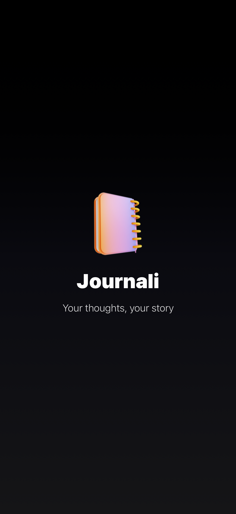
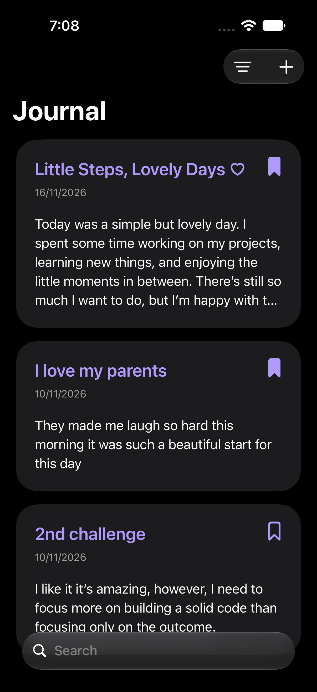
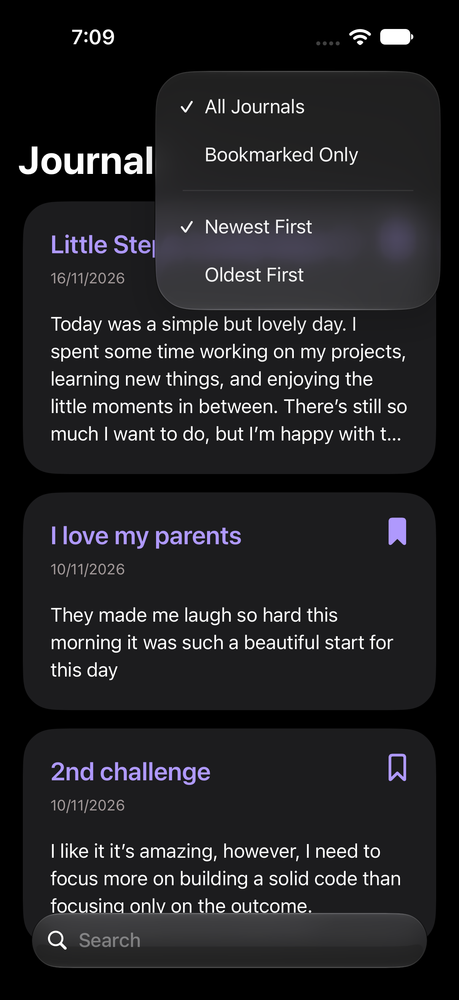
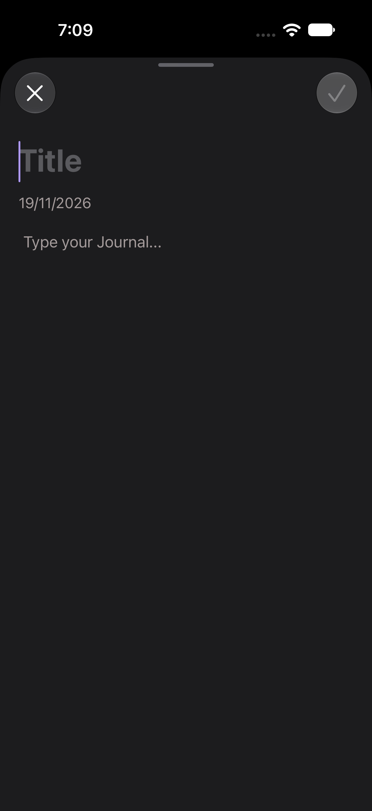
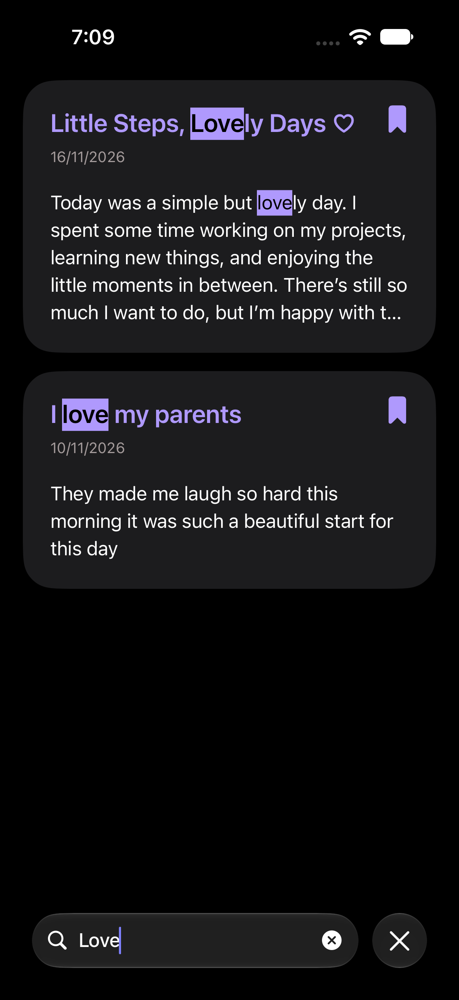

# Journali

*Your thoughts, your story.*

Journali is an iOS app for writing and revisiting personal journal entries. Create, edit, search, and bookmark your thoughts, with entries saved locally on your device.

## Description

Built as my second challenge at the Apple Developer Academy, Journali brings a provided interface design to life using SwiftUI. The project helped me practise Swift data modeling, MVVM, native system components, local persistence, and version control with Git and GitHub.

## Main Features

- Create journal entries with a title, content, and creation date.
- Edit saved entries using the same editor used for creating them.
- Confirm before discarding unsaved changes.
- Swipe to reveal the delete action and confirm before deleting an entry.
- Search titles and content for words or phrases, with matching text highlighted in journal cards.
- Open any journal card, including a search result, directly in the editor.
- Add and remove bookmarks, and filter the list to show bookmarked entries only.
- Sort entries by date, newest or oldest first.
- Keep entries and bookmarks saved locally across app launches with SwiftData.
- Show an illustrated empty state when there are no saved entries.

## Screenshots

<table>
  <tr><th>Splash Screen</th><th>Journal List & Bookmarks</th><th>Filtering & Sorting</th></tr>
  <tr><td></td><td></td><td></td></tr>
  <tr><th>New Journal</th><th>Search Highlights</th></tr>
  <tr><td></td><td></td></tr>
</table>

## Technologies Used

- **Swift** for app development.
- **SwiftUI** for the interface, navigation, sheets, search, and alerts.
- **SwiftData** for local journal storage.
- **MVVM** to organise data models, presentation logic, and views.
- **Native system text styles** to support Dynamic Type.
- **Liquid Glass** through native system controls and a prominent glass save button.
- **SF Symbols** for interface icons.
- **Git and GitHub** for version control.

## Project Structure

```text
JournalingApp/
├── App/             # App entry point and storage setup
├── DesignSystem/    # Shared theme and asset catalog
├── Models/          # Stored journal entries and editing drafts
├── ViewModels/      # Validation, search, filtering, and persistence
└── Views/           # Screens and reusable interface components
```

The editor keeps changes in a `JournalDraft` until the user saves them. `JournalViewModel` validates and writes changes to a `JournalEntry`, while SwiftUI displays the stored data and updates the journal list.

## Getting Started

### Requirements

- A Mac with Xcode 27.2 or later.
- An iPhone Simulator or iPhone running iOS 27.2 or later, matching the project's current deployment target.

### Run the App

1. Clone or download this repository.
2. Open `JournalingApp.xcodeproj` in Xcode.
3. Select the `JournalingApp` scheme and a compatible iPhone Simulator.
4. Press **Command + R** to build and run.
5. To run on a physical iPhone, select your development team under **Signing & Capabilities** and choose your connected device.

## Author

Developed by Rawa as part of the Apple Developer Academy.
